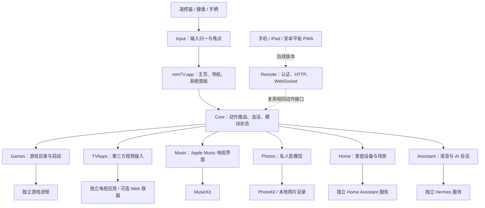

# mmTV 技术架构方案

版本：方案 v1 · 2026-10-26 · 状态：架构基线；当前实现与未验收项见 [docs/STATUS.md](docs/STATUS.md)。

目标：以 Mac mini 为家庭主机，为电视提供遥控器优先的娱乐、影像、音乐、家居和 AI 体验，并逐步开放手机和平板控制。MacBook 用于开发、打包和远程维护。

## 1. 核心决策

采用 **SwiftUI + AppKit 原生主应用、按功能划分的 Swift 模块、独立运行的外部服务**。

第一阶段安装一个 mmTV.app。音乐、照片、游戏、视频、家居、AI 各自拥有明确接口、页面、配置和测试入口，可以分别启用、开发与验收。Hermes、Home Assistant、游戏及第三方视频应用保持独立进程。

代码独立和进程独立分开处理：自研模块先在同一应用内运行，减少部署成本；涉及第三方运行时、长任务、兼容实验或持续后台服务时才使用独立进程。每个模块都可替换，但首版不建设动态插件市场、微服务平台或通用操作系统兼容框架。

### 产品原则

- 日常以方向键、确认、返回、Home、语音和手柄操作；设置与维护可以使用 MacBook。
- 自研页面遵循共同的电视交互规范；接入应用优先选已有 TV 交互的版本。
- 应用接入只承诺经过验证的能力，例如启动、返回、暂停；不伪造续播和播放状态。
- AI 是可选能力。启动游戏、回主页、播放控制与固定家居场景不依赖模型在线。
- 单个模块不可用时，其余功能仍可使用；模块化本身不提供应用内崩溃隔离。
- 界面与领域能力分开，让未来手机和平板能够复用能力接口。

## 2. 总体结构



图中的方框代表职责。首版 Core、Input、各自研功能模块与 Shell 在同一个进程；Remote 在多终端版本引入。外部服务和应用通过适配器连接。

### 推荐技术

| 部分 | 选择 | 用途与约束 |
|---|---|---|
| 电视界面 | SwiftUI | 卡片、海报、照片墙、播放器与状态展示 |
| 系统宿主 | AppKit / NSWorkspace | 窗口、激活应用、进程监听、全屏与焦点恢复 |
| 代码组织 | Xcode + Swift Package Manager | 一个仓库、明确 target 依赖、按模块测试 |
| 输入 | NSEvent + GameController + IOHIDManager | 键盘与手柄走系统事件；小米 RC003 按 VID/PID 读取原始 HID，覆盖非标准返回键与全局 Home，不修改系统键位 |
| 音乐 | MusicKit | 授权、目录和资料库查询、应用内播放 |
| 照片 | PhotoKit + ImageIO + AVFoundation | 系统图库访问、目录缩略图与视频播放 |
| 配置和索引 | Codable JSON + SQLite | JSON 保存小配置；产生媒体索引时引入 SQLite，可用 GRDB |
| 外部服务连接 | URLSession / WebSocket | Hermes、Home Assistant；每个连接由所属模块维护 |
| 多终端 | Hummingbird + WebSocket；轻量 TypeScript PWA | 到需要网络服务时再引入；复用 Core 接口 |
| 生命周期 | SMAppService / launchd | 用户登录启动与必要后台服务；分阶段配置 |
| 日志与凭据 | OSLog + Keychain | 模块日志、诊断导出、服务令牌 |

当前 MacBook 已验证：arm64、macOS 27.0.1、Xcode 路径可用、Swift 6.4。暂以 macOS 15+ 为开发基线建议；V0.0 核对 Mac mini 实际系统后冻结最低版本。使用较新 SDK 不代表产品只能运行于该 SDK 对应的系统，新增 API 必须检查可用性。

## 3. 模块边界

### Shell / Input：统一电视体验

Shell 只负责入口、导航、焦点恢复、全局 Home、设置、AI 展示和模块状态。功能页面由各模块提供，音乐业务不写进主页，第三方应用按键不散落在全局导航里。

Input 将键盘、遥控器、手柄转换成方向、确认、返回、Home、媒体键及语音按下/松开事件。独立 FocusCoordinator 管理空间导航、焦点记忆、长按重复与返回栈。

当前实体遥控器基线为“小米蓝牙语音遥控器”RC003（VID `0x2717`、PID `0x32B8`、固件 `2671`）。Input 直接监听该设备的原始 HID usage，并与 macOS 产生的普通键盘事件去重；方向、确认、返回、Home、菜单、音量和语音触发进入统一 `RemoteEvent`。三横线菜单键实测为 Keyboard usage `0x65`，用于切换右上角“菜单与设置”。mmTV 内部所有主页、模块页、设置、弹窗和系统文件面板共享分层输入路由，返回键优先关闭最上层。音量键通过 CoreAudio 调整当前 macOS 输出；不支持软件音量的 HDMI 设备明确降级为电视/音响控制。语音键已识别物理触发，等 Hermes 阶段再接 ATVV 音频；电源键不被 mmTV 拦截，避免误触发休眠或关机。

输入按照当前会话路由：在主页由 Shell 消费，在自研页面由当前页面消费，在外部应用中按该应用已验证的映射处理。游戏期间手柄交给游戏，Shell 避免重复消费。全局 Home 与独占全屏应用的行为必须实测，不能只依赖本应用内的键盘监听。

### Games：游戏模块

负责游戏目录、封面、资源位置、启动配置、启动/运行状态、退出后恢复主页。支持已安装 App；现有塞尔达若通过启动器或脚本运行，则配置启动器与真正游戏进程的识别方式。

启动优先使用 Bundle ID 和 NSWorkspace。脚本类游戏使用本机明确配置的可执行文件与参数数组，不把网络请求或语音文本拼成 shell 命令。只监听启动器退出不足以判断游戏结束。

返回主页仅切换前台，不默认终止游戏。退出与强制结束为独立动作，避免丢失进度。硬盘离线时显示不可用并提供修复入口。

### TVApps：第三方视频应用

每款应用一个小适配器，配置应用标识、启动方式、全屏策略、按键映射，以及实际支持的播放控制、深链接和状态读取能力。

首个闭环只需一款 YouTube TV 交互客户端和一款 B 站客户端，具体选型以真实登录、播放、遥控和返回实验为准。后续按需求加入 Plex、Infuse、网易爆米花、优酷、爱奇艺、WeTV、Netflix、Spotify、KKBOX；Apple Music 与照片由独立自研模块承担。应用清单保留，所有应用同时兼容不作为 V0.1 的前置条件。

优先运行独立成熟 TV 客户端；需要移植电视 Web 应用时，先为一个应用做容器与少量平台适配，第二款应用证明可复用后再抽取公共 TV Web Runtime。WebKit 与 Chromium 的播放器、DRM、登录兼容性分别验证，不预设一个 WebView 能覆盖全部平台。

TVCompat 和 Android TV 兼容实验置于独立实验目录与进程中。只有通过真实应用验收后，才以一种新的启动适配器接入 TVApps。研发失败或暂停不阻塞主系统发布。源码移植、模拟器运行、原始二进制兼容分别记录，不能混为同一成果。

### Music：Apple Music 电视应用

采用自研 SwiftUI 电视界面和 MusicKit，首版完成授权、资料库/歌单、搜索、播放队列、播放/暂停、上一首/下一首与 Now Playing。

使用 ApplicationMusicPlayer 管理应用内播放。账户授权、订阅可播放能力、地区与具体内容可用性由模块检查；授权失败时展示可恢复状态。开发者账户、MusicKit capability、签名与发行配置在 V0.0 做最小验证，不等到整套 UI 完成后才发现播放不可用。

该模块只拥有自身的音乐会话。系统播放协调器可以要求它暂停，但不会假设能够接管所有第三方播放器。跨设备初期只控制 Mac mini 的音乐播放；平板独立播放 Apple Music 属于后续单独授权与播放器接入。

### Photos：私人影像馆

提供照片时间线、相册、全屏查看、视频播放与幻灯片；数据源通过小接口隔离：PhotoKitSource 访问该 Mac 用户授权的系统照片图库，FolderSource 访问用户选择的本地目录。

Google Drive 的备份不会自动成为 PhotoKit 图库。若现有资源主要在 Drive，首版可通过已同步到本机的目录进入 FolderSource；云端同步作为后续独立任务。系统图库授权、iCloud 原片未下载、文件离线与缩略图加载均需有状态反馈。MacBook 与 Mac mini 的图库和授权分别配置。

默认只读浏览。索引保存资源引用、元数据与缩略图位置，不复制整个图库，也不修改 Photos.library 内部数据库。缓存有空间上限，外置硬盘重新挂载后可恢复扫描。使用卷标识和用户重新定位机制，避免把固定 /Volumes 路径写死在代码中。

### Home：Home Assistant

Home Assistant 独立部署，可运行在 Mac mini 的专用 VM 或现有其他主机。mmTV 模块只是客户端，通过 REST 调用动作，通过 WebSocket 订阅状态。家居自动化规则主要保留在 HA 中，Shell 关闭后仍继续执行。

首版范围为指定设备、区域、常用场景与状态。控制服务动作与修改实体显示状态分开；实际控制设备调用 HA 动作接口。断连后重连、重新获取状态快照并恢复订阅；网络超时后不盲目重试可能重复执行的动作。

### Assistant：Hermes AI 与语音

Hermes 作为可替换的外部 Agent，通过本机带认证的 HTTP 接口访问。Assistant 模块拥有对话、任务进度、取消、错误恢复和界面；不让其类型或配置进入音乐、照片等模块。

语音链路为：遥控器采音适配器 → STT → 意图处理 → 固定动作或 Hermes → 结果展示，可选 TTS。开发期可先用文字和 MacBook 麦克风验证，遥控器语音在 Mac mini 单独验收。Agent 可执行计划时须进入受控执行路径；仅把工具描述放进提示词不足以限制其系统权限。

固定命令直接调用已注册动作；复杂搜索、规划交给 Hermes。模型返回文本不代表动作成功，界面以执行器结果和终态显示成功、失败或取消。UI 取消与远端任务真正停止分开验证。

### Remote：多终端控制

先做手机/平板网页控制端：配对、方向键、文字输入、Home、已接入播放会话控制、家居场景。后续增加照片浏览、选择在电视播放和资源访问。

HTTP 提供查询与命令，WebSocket 推送状态。客户端发送领域动作，服务端检查权限并路由到同一 Core；不通过远程桌面完成普通遥控。

第一版网络网关运行在 mmTV.app 内，退出应用时明确显示控制服务离线。当出现“退出电视界面后仍需远程访问资源”的实际需求，再把需要常驻的能力迁到 HomeHub 用户代理进程；它不重复打开 MusicKit 播放器或 PhotoKit 图库。网络请求经用户会话执行器操作 GUI。

## 4. 模块如何保持独立

初期采用一个 Swift package 中的多个 targets；下面是规划目录，尚未创建代码：

```text
Apps/mmTVMac/            应用入口、依赖组装、窗口与签名配置
Packages/mmTV/
  Sources/Contracts/           小型领域类型与接口
  Sources/Core/                动作路由、模块注册、会话协调
  Sources/DesignSystem/        TV 组件、尺寸、焦点样式
  Sources/Input/               键盘、遥控器、手柄
  Sources/Games/
  Sources/TVApps/
  Sources/Music/
  Sources/Photos/
  Sources/Home/
  Sources/Assistant/
  Sources/Remote/              多终端阶段加入
  Tests/                      按模块组织
Web/Control/                   多终端阶段加入
Experiments/TVCompat/           独立兼容研究
Config/                        无密钥配置模板
Scripts/                       构建、打包、诊断
docs/                          决策、验收与部署记录
```

依赖规则：各功能模块依赖 Contracts，页面可依赖 DesignSystem；模块间不直接 import。Core 依赖 Contracts，不依赖具体模块，App 入口负责装配实现。Input 和 macOS 系统操作通过接口注入。确实需要独立发布时再把 target 拆成 package，不提前拆多个仓库。

每个模块提供真实实现与测试替身；主应用支持开发启动参数只加载指定模块，用同一个宿主独立调试。模块拥有自己的配置命名空间、数据表/迁移和诊断项。禁用某模块无需其他模块修改实现。编译期注册足够，首版不动态下载执行插件。

### 只统一必要的契约

| 契约 | 内容 |
|---|---|
| ModuleDescriptor | id、标题、入口、启用状态、配置状态、能力清单 |
| Action | 已注册的动作 id、结构化参数、来源、requestId |
| ActionResult | 成功/失败/不支持；长任务返回 taskId，并订阅终态 |
| ModuleStatus | disabled、needsSetup、ready、degraded、unavailable |
| Session | 当前前台应用、输入归属、当前可控播放提供者 |

动作示例：games.launch(gameId)、music.play(itemId)、photos.show(albumId)、home.activateScene(sceneId)、system.showHome。参数按动作定义校验，不做任意字符串反射或任意代码执行。首版内部接口保持强类型；引入 Remote 时再为外部暴露必要的可序列化动作。

## 5. 状态、播放与故障处理

应用前台状态与音频播放状态分别维护。主页恢复不等于游戏退出，打开照片也不等于音乐必须停止。

播放协调规则：音乐可伴随主页/照片继续播放；进入游戏或视频前，默认暂停自身可控音乐；外部视频不可观测时，显示已打开应用，不展示虚构进度。返回后是否恢复音乐由用户设置，首版默认不自动恢复。播放器切换先结束或暂停旧会话，再更新输入归属。

网络、索引和图像处理不阻塞主线程。主界面状态在 MainActor 更新，长任务可取消；缩略图按需加载并限制并发。HA/Hermes 请求有超时、退避与离线状态。读操作可重试，产生副作用的命令需 requestId 和执行结果核对，无法确认结果时显示未知而非直接重复执行。

自研模块同进程，捕获网络与业务错误只能隔离可恢复故障，不能隔离原生崩溃。需要隔离的兼容运行时在外部进程中。UI 异常重启时回到安全主页，不自动重启游戏或重放家居动作。

## 6. 开发与部署

MacBook 开发、Mac mini 安装运行完全可行。两台都是 Apple Silicon 时优先交付 arm64 构建。Mac mini 无须为了运行应用安装完整 Xcode；外部组件按安装清单配置。

开发使用 development profile、示例媒体、模拟 HA 和 Hermes；生产使用独立配置与凭据。路径、Bundle ID、服务地址、音频设备和启用模块均可配置，代码不写死 MacBook 用户目录。两台机器不共享正在使用的 SQLite 数据库文件。

### 交付流程

1. MacBook 编译、模块测试、键盘/手柄导航检查，产出带版本号的 Release .app 和依赖清单。
2. 核实签名能力；开发阶段使用合法开发签名与实际 entitlement 验证，个人机器可本机构建试运行。日常分发建议 Developer ID 签名、公证和 Hardened Runtime；不以关闭 Gatekeeper 或全局安全保护为安装步骤。
3. 将应用安装到 Mac mini；通过首次设置选择媒体目录、游戏、服务地址，完成 MusicKit/照片/麦克风及确实需要的辅助功能等授权。授权和账户不会从 MacBook 自动迁移。
4. 单独安装和配置遥控器组件、Hermes、Home Assistant 与第三方应用，逐项健康检查。账户、令牌和 Keychain 项不写进仓库或发行包。
5. 验证 TV 模式、HDMI 画面和声音、遥控器、全屏应用返回、休眠/唤醒、外盘掉线和网络故障；通过后设为日常入口。
6. 保留上一版本与配置备份；升级前备份数据库。数据库迁移后回滚应恢复匹配的备份，不能只替换旧 .app。

在 V0.1 就部署首个小版本到 Mac mini，此后每个可用版本都实机验证；不等全部功能完成才第一次上电视。

### 运行与数据位置

应用安装于 /Applications；配置与数据库放在当前用户 Application Support/mmTV 下，缓存放 Caches/mmTV。媒体保留在用户选择的系统图库或外置卷。登录启动按用户设置注册；GUI 和照片/音乐授权依赖已登录用户会话。

后台 HA 可独立运行。首次重启、FileVault 解锁、用户登录与 VM 启动恢复单独验收，不承诺锁屏前所有图形能力已恢复。电视关机后保留家庭服务，停止不必要的媒体任务。HDMI 音量可能需要电视侧控制，不能默认 macOS 软件音量可调。

首版面向个人设备直接分发；主应用是否启用 App Sandbox 需结合全局输入、外部进程及脚本启动实验决定，V0.0 记录结果。音乐、照片与麦克风等权限仍按系统要求声明。兼容实验不改变主应用发行包的权限和运行时约束。

## 7. 多终端与常驻进程的演进条件

V0.1—V0.5 主要运行单元：mmTV.app、独立 HA、按需 Hermes、使用中的游戏/视频应用与遥控器组件。

V0.6 增加应用内 Remote 网关与 PWA，控制服务跟随 App。若后续要求 UI 退出后继续浏览本地照片目录或使用家庭 API，再增加 HomeHub 用户 LaunchAgent；资源索引和控制网关迁出，图形操作留在用户会话 App，双方用明确 IPC 连接。每种能力只由一个进程持有，避免双播放器、双扫描与多数据库写者。

远程端首次配对，设备可撤销；令牌存在 Keychain，控制与管理权限分开。网页通过 HTTPS 提供需要的安全上下文，WebSocket 校验身份与来源；首版局域网使用。客户端重连先取快照再订阅增量，超时指令不得无条件重发。Apple Music 的音频不经自建服务器转流；照片远程展示只输出已授权、按需生成的资源，不能把整个磁盘目录直接映射给浏览器。

## 8. 验证重点与待定项

已验证的是开发环境与公开接口存在，并未验证这台 Mac mini 的完整产品链路。V0.0 优先确认以下事项，结果写入验收记录：

| 项目 | 如何验证 | 影响范围 |
|---|---|---|
| Mac mini 系统、架构与签名 | 实机记录系统版本，安装最小签名 App | 最低系统版本、打包方式 |
| Apple Music | 目标发行配置下授权、查询并播放一首可用歌曲 | Music 实现与账户配置 |
| 照片来源 | 授权读取系统图库；选择实际本地同步目录 | PhotoKitSource / FolderSource 启用顺序 |
| 遥控器与语音 | 核对型号，测试按键、长按、音频与全局 Home | Input 适配器 |
| Hermes | 所用版本认证、流式响应、任务取消与工具执行 | Assistant 适配器；不影响游戏等模块 |
| 视频候选 | 登录、播放、方向导航、返回、声音 | 每应用能力清单 |
| HA | 可达、令牌有效、动作与状态订阅 | Home 配置 |
| HDMI/电视 | 画面、声音、开关电视、唤醒和输入源 | 部署与系统恢复 |

## 9. 依据

- [Apple MusicKit](https://developer.apple.com/musickit/)：官方 Apple 平台音乐能力、授权与订阅检查。当前本机 SDK 显示 ApplicationMusicPlayer 支持 macOS 14+。
- [PhotoKit](https://developer.apple.com/documentation/photokit) 与 [图库变化观察](https://developer.apple.com/documentation/photokit/observing-changes-in-the-photo-library)：读取授权图库和增量更新。
- [Hermes API Server](https://hermes-agent.nousresearch.com/docs/user-guide/features/api-server)：官方带认证 HTTP 接口；具体接口以最终固定版本实测为准。
- [Home Assistant REST](https://developers.home-assistant.io/docs/api/rest/) 与 [WebSocket](https://developers.home-assistant.io/docs/api/websocket/)：动作调用、认证与状态订阅。
- [Hummingbird](https://github.com/hummingbird-project/hummingbird)：后续 Swift HTTP 服务选型。
- [SMAppService](https://developer.apple.com/documentation/servicemanagement/smappservice) 与 [Developer ID](https://developer.apple.com/developer-id/)：登录服务及直接分发路线。

版本顺序、交付物与验收门槛见 [ROADMAP.md](ROADMAP.md)。
